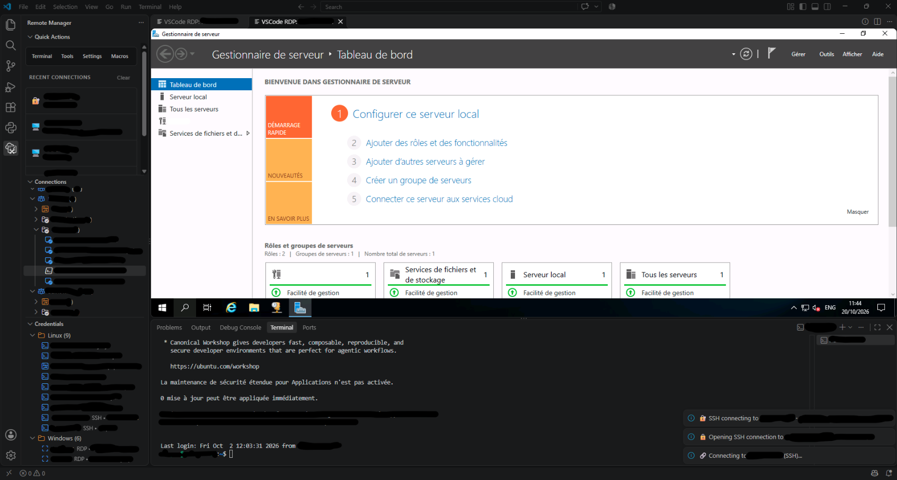

# Remote Manager - Professional Connection Manager

A **modern**, **secure**, and **feature-rich** VS Code extension for managing multiple Remote Desktop (RDP), SSH (with certificate/key support), and other remote connections with enterprise-grade architecture and comprehensive testing.

**New to Remote Manager?** Read the [User Guide](USER_GUIDE.txt): everyday tasks first, the occasional tools last. It also opens from **Quick Actions > Help > User Guide**.



## VSCode RDP

Right-click a saved **RDP** connection and select **Connect with VSCode RDP**.
VSCode RDP is included in the stable release for the supported environment described below.
The normal click, **Connect** command and connection history use your default RDP client.
Choose **External RDP client** (the initial default) or **VSCode RDP** in
**Settings > Remote Manager > Connection Preferences: Default Rdp Client**,
or use **Quick Actions > Settings > Connection Preferences** to find it.
The choice applies to new sessions immediately and leaves existing sessions unchanged.
**Connect with VSCode RDP** always opens the integrated client, regardless of the default.

```json
{
  "remoteManager.connectionPreferences.defaultRdpClient": "vscode"
}
```

Set it to `"external"` to return to the usual RDP client. If the integrated client is
unsupported or fails, it reports the error rather than silently switching clients.

- The VSIX includes the IronRDP WebAssembly engine and a JavaScript WebSocket-to-TLS relay.
  Users do not need Docker, Java, FreeRDP, a separate gateway, or another installation.
  No additional executable is downloaded or started by this feature, and no Windows service is installed.
- The relay runs in the extension host, binds only to `127.0.0.1` on an OS-assigned port,
  checks the webview origin and a random per-session token, and can connect only to the selected server.
  Closing the tab or unloading the extension closes the relay and its connections.
- Requires a **local VS Code Desktop window**, a trusted workspace, network access to the RDP server,
  **TLS 1.2+**, **NLA/CredSSP**, and server certificate verification (PKI or explicit fingerprint approval).
  Web VS Code, Remote SSH, WSL and dev-container extension hosts are not supported.
- Certificates are checked against the extension host's Node.js TLS trust configuration.
  **CA-signed certificates are supported** and are accepted without a fingerprint prompt when
  the issuing chain is trusted by that runtime, the certificate is within its validity period,
  and the server name matches. A signature alone does not establish trust: a private corporate
  CA must also be trusted by the extension host, and the server must present its required chain.
  Windows trust-store membership alone does not guarantee trust in every VS Code/Node.js runtime.
  The certificate must permit TLS server authentication and have key usages compatible with
  the negotiated TLS configuration, such as Digital Signature when required by the TLS cipher suite.
  A recognized certificate must match the configured hostname (an IP connection requires an IP SAN).
  For an unknown issuer or a self-signed certificate, a modal displays the server, certificate
  subject, issuer, expiry and SHA-256 fingerprint. **Verify the fingerprint independently with
  your administrator before selecting "Trust This Certificate".** Cancel leaves the connection blocked.
  Explicit approval binds the exact certificate to the selected server and port, including when
  using an IP instead of the certificate's DNS name. No password or CredSSP authentication is sent
  before verification/approval completes.
- Approved fingerprints are saved in VS Code SecretStorage. A changed untrusted certificate requires
  a fresh approval and displays both the previous and new fingerprints. Use **Forget VSCode RDP Certificate**
  from the RDP context menu or command palette to remove an approval; close any existing session
  and reconnect to apply the change. Expired/not-yet-valid certificates and recognized certificates
  with a hostname mismatch remain rejected. There is no global "ignore certificate" switch.
  A certificate issued by your organization's trusted CA remains the recommended enterprise setup.
- Uses the assigned connection credential, or its group credential, from VS Code SecretStorage.
  Missing credentials are prompted for the current session only. Passwords are not placed in
  HTML, URLs, command lines or logs. The embedded engine necessarily holds session credentials in memory.
- Close the information bar with its cross to use the full editor area. Check **Do not show again**
  before closing to persist the choice in your VS Code user settings. The **Show VSCode RDP Controls** (ⓘ)
  button in the tab title bar restores the bar without covering the desktop; errors always reveal the controls.
  Re-enable `remoteManager.vscodeRdp.showInformationBanner` to show it by default again.
- Errors appear in a theme-aware notification card with a clear heading, suggested next steps
  and expandable diagnostic details. Recoverable action errors can be dismissed without ending
  the session; normal session completion uses an informational style.
  Close the editor tab to end a session and release the relay: there is no separate Disconnect button.
- By default, the remote desktop requests the viewport's available size (up to 3840x2160), including
  after hiding/restoring the bar or resizing the editor. Requires server display-control support;
  otherwise the desktop is scaled to fit the tab, centred and with its aspect ratio preserved.
  A resize the server has not applied after 2 seconds is requested again, up to 3 times.
  Disable `remoteManager.vscodeRdp.autoResize` to retain a 1280x720 remote resolution.
- **Plain-text clipboard** is enabled by default with `remoteManager.vscodeRdp.clipboard`.
  Local text is shared when focusing/pasting into the active session; remote text copies replace the local
  clipboard. Synchronization uses the VS Code clipboard API, not browser clipboard permissions.
  The connection's `redirectClipboard=false` disables text sharing, and
  `remoteManager.security.disableClipboardShare` disables both text and file redirection.
- **File transfer** is opt-in with `remoteManager.vscodeRdp.fileTransfer`. Reconnect after enabling it.
  Select **Send files...**, choose local files, then paste in the remote Explorer with Ctrl+V.
  To download, copy files in remote Explorer, choose a file from the controls and select **Save remote file...**.
  Every download opens a VS Code save dialog; no remote-supplied path is written automatically.
  Transfers use CLIPRDR, not shared drives. Limit: 16 MiB per download; at most 32 files and 16 MiB
  total per upload batch. Downloads are chunked, one at a time; folders are not supported.
  File copy and text copy share the same remote clipboard, so starting one can replace the other.
  Transfers remain subject to server/GPO redirection permissions.
- **Audio, microphone, shared drives and printer redirection are not exposed by this engine build.**
  They have no nonfunctional enable switches. Use the unchanged external **Connect** command if needed.
- Use the bar's **Settings** button to find VSCode RDP options. Reconnect after changing redirection
  or resize settings. Disabling sharing also blocks clipboard/download host access immediately and
  restricts the existing browser redirections; enabling sharing requires reconnection.
- Keyboard and mouse input are supported;
  printable characters use Unicode for international layouts. Some shortcuts are intercepted by
  VS Code/the OS; dead-key/IME composition and all keyboard layouts are not yet validated.
- Successful connections appear in the existing history. Selecting an RDP item from history
  uses the current default RDP client.

**AV/EDR:** avoiding extra executables and services reduces deployment friction, but cannot
guarantee approval by security products or enterprise policy. WebAssembly, local listeners and
outbound RDP may still be restricted. Do not disable protection or add blanket exclusions;
have the extension reviewed and approved through your organization's normal process.

**Validation and release scope:** automated tests cover destination parsing, bounded RDCleanPath
messages, session authorization, origin rejection, fragmented negotiation, real local TLS
transport, explicit certificate approval/refusal, expiry/hostname rejection and cleanup. Browser smoke testing covers loading the packaged
WASM engine and sending its negotiation through the relay. These checks do not replace a real
Windows RDP/NLA session test or an enterprise AV/EDR compatibility assessment. The stable
release label does not imply certification for every server version, policy or security product.
UI/bridge tests also cover banner dismissal, resize requests, redirection defaults, clipboard
sharing, bounded file transfers and download payload validation. These are not live-server
end-to-end tests of all redirection policies.

Negotiation errors now identify certificate validation codes, network failures and server security
negotiation failures instead of showing only a generic error. A late relay diagnostic takes
precedence over a generic browser transport error.

Development validation: `npm run test:web-rdp`.
The browser engine is supplied by [ironrdp-wasm](https://github.com/electerm/ironrdp-wasm),
built from [IronRDP](https://github.com/Devolutions/IronRDP). Third-party licenses are distributed
with their packages in the VSIX; see also [the VSCode RDP notice](assets/web-rdp/NOTICE).

The feature was previously called Web RDP. Existing command identifiers, internal resource paths
and stored certificate approvals are retained for compatibility; all current UI labels use VSCode RDP.

## Serial Console

Serial connections open the console port of Cisco switches and routers (and any other equipment with an RS-232
or USB console) through a console cable. Create a connection of type **Serial Console**: the serial ports of the
computer are listed with their names (for example `USB Serial Port (COM3)` on Windows or
`/dev/serial/by-id/usb-FTDI_...` on Linux), then choose the speed, the frame format and the flow control.
The defaults are those of a Cisco console: **9600 8N1, no flow control**.

- **Built-in console** (default): a VS Code terminal connected to the port. Nothing needs to be installed: it uses
  Windows PowerShell and .NET on Windows, `stty` on Linux and macOS. Keystrokes such as Ctrl+C and Ctrl+Z go to the
  device; VS Code keeps a few shortcuts for itself (Ctrl+P opens Quick Open: use the arrow keys for the command
  history, or enable `terminal.integrated.sendKeybindingsToShell`).
- **Send Break**: while a built-in console is the active terminal, a **⚡ Send Break** button appears in the status bar
  (also *Remote Manager: Send Break to Serial Console* in the Command Palette). It is what Cisco password recovery and
  ROMMON need. On Linux and macOS it uses `python3` or `perl`, which are present on almost every system.
- **Unplugged cable or busy port**: the terminal says why the port closed. Press Enter to reconnect, any other key to
  close the terminal.
- **Direct connection**: **Quick Actions > Tools > Serial Console** (or *Tools: Serial Console (Direct Connection)* in
  the Command Palette) opens a port without creating a connection: pick the port, keep the offered settings
  (9600 8N1, then the last ones used) or change them, and the console opens.
- **Other programs**: *Connect With...* on a serial connection opens it once with plink, PuTTY, picocom or screen when
  they are installed; `remoteManager.serial.defaultClient` makes one of them the default.
- **Linux permissions**: the account must be allowed to use the port, usually by joining the `dialout` group
  (`sudo usermod -aG dialout $USER`, then log in again).

## WSL Connections

WSL connections open a WSL distribution installed on this computer (Windows only). Create a connection of type
**WSL**, pick the distribution among the installed ones, then choose what it opens:

| Protocol | What opens | Default port |
|----------|------------|--------------|
| **Shell** | A VS Code terminal in the distribution (`wsl.exe -d <distribution>`), optionally as a given Linux account | – |
| **SSH** | An SSH session to the SSH server of the distribution, with the credential of the connection | 22 |
| **RDP** | The graphical desktop of the distribution through xrdp, with the external Remote Desktop client | 3390 |
| **Telnet** | A Telnet session to a Telnet server of the distribution | 23 |

- *Connect With...* opens a WSL connection once with another protocol.
- For SSH, RDP and Telnet, Remote Manager starts the distribution if needed and waits until its server answers. It
  connects to `localhost`, where WSL forwards the ports of the distribution, or to the address of the distribution
  when that forwarding is off or blocked.
- WSL stops a distribution shortly after its last `wsl.exe` process ends, even when sshd or xrdp still run in it.
  Remote Manager therefore keeps a distribution used for SSH, RDP or Telnet running (a hidden `wsl.exe` that only
  sleeps) until VS Code closes; `wsl --terminate <distribution>` stops it earlier.
- The servers are not installed by Remote Manager. For example on Ubuntu or Debian:
  `sudo apt install openssh-server` then `sudo service ssh start`, or `sudo apt install xrdp` and `port=3390` in
  `/etc/xrdp/xrdp.ini` (3389 is used by Windows), then `sudo service xrdp start`.

## Web Connections

Web connections open the web interface of a server or device (iDRAC, iLO, ESXi, Proxmox VE, switches, firewalls...)
in a VS Code tab. An address without `http://` or `https://` is opened with `https://`; write `http://` in front of
devices that only serve HTTP.

VS Code shows the page in a frame of its own window, which many management interfaces do not allow. Before opening the
tab, Remote Manager reads the headers of the address and of its redirects (one request each, without credentials) and,
when the interface cannot work inside VS Code, offers to open it in the default browser instead:

| Found | Inside VS Code | Offered |
|-------|----------------|---------|
| HTTPS certificate not trusted by this computer (self-signed, expired, issued for another name: the factory setting of most devices) | Error page, the certificate cannot be accepted | Browser |
| `X-Frame-Options: DENY` or `SAMEORIGIN`, or a `Content-Security-Policy` with `frame-ancestors` | The page is refused | Browser |
| HTTP authentication (Basic, Digest, NTLM, Negotiate) | The sign-in prompt is never shown | Browser |
| Cookies other than `SameSite=None; Secure` | Dropped, so signing in usually does not hold | Browser or VS Code |
| No answer from VS Code | – | Browser or VS Code |

- Inside VS Code, confirmation dialogs (`confirm()`, `alert()`) and downloads are not available: use *Open in browser*
  at the top of the tab.
- A certificate trusted by Windows (company authority, or the device certificate imported in the certificate store)
  lets the page open inside VS Code when the interface allows frames.

## 🆕 What's New in v1.0.58

- **The saved SSH password is typed again when the default terminal is cmd.exe** (for example the JavaSE profiles of the Java extensions): VS Code does not report the output of cmd.exe, so Remote Manager now opens its SSH and plink terminals with PowerShell in that case. PowerShell, pwsh and Git Bash stay as chosen.

## 🆕 What's New in v1.0.57

- **Drag and drop**: drag connections, credentials and whole groups onto a group to move them there, onto an item to join its group, or onto the empty part of the view to reach the top level. A moved group takes its sub-groups, items and group credentials along.
- **Multiple selection**: Ctrl-click or Shift-click several items, then drag them together, or right-click and use *Delete* (one confirmation) or *Move to Group*. *Move to Group* is also offered on a group.
- **Sort By...** in the "..." menu of both views: name A → Z (numbers in natural order) or Z → A, protocol, host or user name, or a **custom order** set by dragging an item onto another one or with *Move Up* / *Move Down*.
- **Expand All** next to the *Collapse All* button of VS Code, at the same place in both views; it opens every group at every depth.
- **User Guide** in *Quick Actions > Help*: how to use Remote Manager, from everyday tasks to the occasional tools ([USER_GUIDE.txt](USER_GUIDE.txt)).
- Credentials view: *Export* / *Import Credentials (Encrypted CSV)* moved to the "..." menu.
- **Fixes**: the protocol groups of the Credentials view showed no credentials; credentials of a sub-group whose top-level group had none of its own were not shown; group counts included a sibling group with a similar name (`Web` and `Web2`); deleting a sub-group could make its emptied parent disappear. Details in the [CHANGELOG](CHANGELOG.md).

## 🆕 What's New in v1.0.56

- **Create Group button**: a folder button in the title bar of the Connections and Credentials views creates a top-level group, which stays visible while empty, ready for new or moved items.

## 🆕 What's New in v1.0.55

- **Another SFTP extension is pointed out**: VS Code gives `sftp://` addresses to one extension only. When another installed extension also opens them, a warning at startup names it, since the Remote Manager file browser and that extension cannot both work in a window.
- **VSCode RDP engine updated** to ironrdp-wasm 1.2.0.
- **Passwords out of command lines and terminal state**: RDP *Connect* types the saved password at the prompt of `cmdkey` in a hidden terminal instead of passing it as `/pass:` (which other programs and security logs can read), and leaves the credentials you saved yourself in Windows untouched. *Connect with PSSession* reads the password from a one-shot file instead of the terminal environment, which VS Code saved on disk to restore terminals. plink, PuTTY and the SSH key generator no longer receive a password or passphrase as an argument.
- **SSH macros wait for the remote shell**: commands are typed once the remote prompt shows (or when you click **Send Commands**), never into the local shell after a failed connection. Macros use the same credentials as *Connect*, run on Telnet connections, keep the commands you edited, and replace only `$HOST` and `$USER`. See [SSH Macros](#ssh-macros).
- **Safer imports**: connections of an imported file that point at credentials already saved on this computer, directly or through a group of this computer, only use them after you confirm; until then those placed in a group wait in "Imported/…". Network paths for keys and certificates are ignored.
- **The saved password stays with the login**: it is typed again only while the login goes on (refused password, next host of a ProxyJump), never into sudo, su or another server after the login, even when the shell prompt is not recognised.
- **Group credentials**: assigning another credential to a group now takes effect, and the assignments follow a renamed group and disappear with a deleted group or credential. PuTTY, VSCode RDP and PSSession use them like *Connect*.
- **RDP custom commands**: *Edit Custom Command* keeps the Remote Desktop launch command and the PowerShell session command apart.
- **Edit Connection keeps the settings** of a connection when a step is left with Escape, and checks host names like the connection editor. SSH and Telnet connections accept IPv6 addresses.
- **Fixes**: SFTP moves between servers, symbolic links to folders and a *Refresh* that shows changes made on the server, the Remote Files view, *Assign Macro to Connection*, Macro Library delete button, Connection Tester outside PowerShell, *Reset Storage* (which now deletes the secrets too). Details in the [CHANGELOG](CHANGELOG.md).

## 🆕 What's New in v1.0.53

- **SSH passwords typed at the prompt**: Connect, Connect with SSH, Connect with Root and SSH macros type the saved password once ssh shows its password prompt, however long the server takes, instead of after a fixed delay. With root access, `su -` waits for the shell prompt and the root password for the su prompt (also `Mot de passe :`), so it is never displayed. Without shell integration a **Type Password** button lets you choose the moment. See [Security Features](#️-security-features).

## What's New in v1.0.52

- **Web connections offer the browser** when the interface cannot work inside VS Code: untrusted (self-signed)
  certificate, page that refuses frames, HTTP sign-in prompt, or cookies VS Code would drop. The dialog says why.
  See [Web Connections](#web-connections).

## What's New in v1.0.51

- **Serial console connections** for Cisco and other console ports: built-in terminal with nothing to install, port
  detection, Send Break, and plink, PuTTY, picocom or screen as alternatives. Quick Actions > Tools > Serial Console
  connects directly without saving a connection. See [Serial Console](#serial-console).
- **WSL connections**: a shell, SSH, RDP (xrdp) or Telnet to a local WSL distribution, which is started and kept
  running for the session. See [WSL Connections](#wsl-connections).
- **Creating a connection asks for its type first**, then for the host, serial port or distribution.

## What's New in v1.0.50

- **SSH with automation works in VS Code stable**: *Connect with SSH* (RDP connections) and *Connect with Root* detect the password prompt through shell integration instead of a proposed API that VS Code stable refuses, so the saved passwords are sent again.
- **Keys and certificates in terminals**: SSH terminals, root sessions and macros now pass the credential's private key (`-i`) and certificate (`CertificateFile`); the SFTP browser uses the saved key passphrase.
- **No password in the shell history**: plink reads the password from a file only you can read (`-pwfile`, PuTTY 0.77 or later), and `{password}` in PSSession custom commands becomes a PowerShell variable. Accented passwords now reach SSH servers correctly with plink.
- **External RDP**: mstsc now warns when it cannot verify the server identity (`remoteManager.security.rdpServerAuthentication`, set it to `none` for the former silent mode), and `security.disableClipboardShare` also applies to it.
- **Fixes**: Connect honours the Telnet port; PuTTY over Telnet starts again (plink refuses `-pw` for Telnet); connections without a user name start ssh; exported connections keep their credential when imported elsewhere; the SFTP browser uses the port written in the host name and group credentials.
- **Safer data handling**: the encrypted CSV import checks every row and asks before replacing stored credentials, deleting a credential deletes all its secrets, generated SSH keys go to `~/.ssh` and the private key is no longer printed in the Output panel. Details in the [CHANGELOG](CHANGELOG.md).

## What's New in v1.0.49

- **Presentation screenshot** on the README and Marketplace page.
- **Repository link** fixed to [Mavenshu/Remote-Manager](https://github.com/Mavenshu/Remote-Manager).

## What's New in v1.0.48

- **VSCode RDP fills the tab**: The remote desktop is no longer shifted to the right and cropped on its right edge, and it follows every editor resize (opening the terminal panel, splitting, resizing the window) instead of applying the previous size.
- **No more floating button**: The blue **VSCode RDP controls** button that covered the remote desktop is removed. Reopen the information and file transfer bar with the **Show VSCode RDP Controls** (ⓘ) button in the tab title bar.
- **More reliable resizing**: Desktop widths are always even, as RDP requires, and a resize the server has not applied is requested again (up to 3 times) before the status line reports it.

## What's New in v1.0.47

- **Safer connections**: Host names, ports, user names and imported records are validated before they reach a terminal, a shell command or an `.rdp` file; `{password}` in custom commands is escaped for its quotes; the default PSSession command no longer types the password.
- **SSH host keys**: `remoteManager.ssh.strictHostKeyChecking` now defaults to `accept-new` (trust on first use, refuse a changed key). Set it to `no` for the previous behaviour.
- **SFTP browser**: Deleting a non-empty folder works, simultaneous requests share one connection, folder listings stay fresh and long transfers are no longer cut off.
- **Logs**: `security.logLevel` and `security.enableConnectionLogging` are honoured, secrets are masked and the log file rotates at 5 MB.
- **Fixes**: VNC detects a missing viewer, the SSH key generator really uses `ssh-keygen`, the port scanner is truly concurrent and the legacy macro recorder records.
- **Housekeeping**: Dead code and unread settings removed, `npm test` runs every suite without VS Code. Full details in the [CHANGELOG](CHANGELOG.md).

## What's New in v1.0.46

- **VSCode RDP stable release**: Removed the Experimental label from the context menu,
  editor tabs, credential prompts and client page. Existing commands, saved connections
  and certificate approvals remain compatible; the external client remains the initial default.
- **Choose the default RDP client**: Set `remoteManager.connectionPreferences.defaultRdpClient`
  to `external` or `vscode`. Click, Connect and history honor this choice for new sessions.
- **Integrated desktop experience**: Includes dismissible controls, viewport resizing,
  text clipboard sharing, opt-in bounded file transfer and theme-aware diagnostic cards.
  Close the editor tab to end the connection.
- **Certificate guidance**: Clarified support for trusted CA-signed certificates, explicit
  approval of unknown/self-signed certificates, and the TLS/NLA prerequisites.
- **Documented support boundaries**: Local VS Code Desktop only; audio, microphone, shared
  drives and printer redirection remain unavailable in this engine build.

See [the changelog](CHANGELOG.md) for the individual fixes in versions 1.0.42 through 1.0.45.

## 🆕 What's New in v1.0.41

- **Configurable report and log destinations**: Added new settings to choose where network diagnostics reports and Remote Manager logs are stored.
- **Safer default output paths**: Reports and logs now default to system temp folders under `remote-manager/diagnostics` and `remote-manager/logs` instead of writing to a root location like `C:`.
- **Better troubleshooting workflow**: You can now set a custom output directory using the VS Code settings JSON.

Example:

```json
{
  "remoteManager.diagnostics.reportDirectory": "C:\\Users\\jolly\\Documents\\RemoteManager\\Reports",
  "remoteManager.security.logDirectory": "C:\\Users\\jolly\\Documents\\RemoteManager\\Logs"
}
```

## 🆕 What's New in v1.0.40

- **Critical activation fix — blank panel & infinite loading resolved**: Fixed a regression introduced in 1.0.39 where the Connections / Credentials tree views displayed *"There is no data provider registered"* and the Quick Actions webview never finished loading.
  - Tree view providers and the webview are now registered at the very start of activation, before any service that could potentially throw.
  - `SSHMacroManager` storage-directory creation is now resilient to I/O errors.
  - The new `collapse-all` / `expand-all` command registrations are now guarded against duplicate-command errors on extension-host reloads.

## 🆕 What's New in v1.0.39

- **Collapse / Expand All Toggle**: The "Collapse All" button in the Connections tree view is now a toggle. One click collapses all groups; another click expands them all back. The icon switches between collapse and expand states automatically.
- **SSH with Macro — Password Timing Fix**: The password is now sent 3 seconds after the SSH command is launched (up from 1.5 s), ensuring the server has time to display its password prompt before the password is injected.

## 🆕 What's New in v1.0.38

- **Terminal History**: The Quick Actions terminal menu now includes a "Terminal History" option. When selected, it prompts the user to choose between **Linux/Bash** (`history`) or **Windows PowerShell** (`Get-History | Format-Table -AutoSize`) and sends the command to the active terminal.
- **Clear Terminal**: Added a "Clear Terminal" option to the Quick Actions terminal menu to instantly clear the active integrated terminal.

## 🆕 What's New in v1.0.37

- **Security Settings**: Added `Settings > Security Settings`. Only clipboard sharing, connection logging and the log level ever had an effect; the other options listed at the time (encrypt storage, temporary file cleanup and timeout, require SSH key, warn before SSH password, inactivity lock, confirm before deletion) were never read by the code and were removed in 1.0.47.
- **Packaging**: Bumped version to `1.0.36` and generated a new VSIX for release.

## 🆕 What's New in v1.0.35

- **SSH Macro Library Display**: Browse and manage SSH macros from a unified library interface with support for viewing macro details, editing configurations, and executing across multiple servers
- **Enhanced Macro Actions**: Direct access to execute, edit commands, modify server targets, configure execution settings, and view detailed macro information from the library
- **Streamlined Menu**: Simplified SSH Macros menu with consolidated functionality into the unified SSH Macro Library for better UX

## 🆕 What's New in v1.0.34

- **Quick Actions: Export & Import Configuration**: Export and import your connections and credentials directly from Quick Actions > Settings. Uses the built-in import/export service and refreshes the Connections and Credentials views after a successful import.
- **Menu integration**: Added Export/Import entries to the Settings Quick Actions menu and improved routing for settings commands.

## 🆕 What's New in v1.0.33

 - **Root SSH automation improved**: Better synchronization for SSH password entry and `su` escalation commands
 - **More reliable password handling**: Added fallback retries for password prompts when terminal output events are unavailable
 - **Release metadata updated**: Bumped package version and refreshed VSIX release notes

## 🆕 What's New in v1.0.32

- **Quick Assign Credential**: Added `Assign Credential` to the connection context menu for faster credential assignment
- **Privileged port support**: Fixed port prompts so valid ports below `1024` like `22` are accepted during connection editing
- **Stable package update**: Built a new production-ready VSIX for the latest stable version

## 🆕 What's New in v1.0.31

- **Better Credential Distinction**: Enhanced credential selection UI to display both credential name and username
- **Improved Credential Labels**: Fixed issue where credentials with same username displayed identically
- **Clearer Group Assignment**: Better information display when moving credentials between groups

## Previous Release - v1.0.30

- **Clean UI Design**: Removed scrollbars from Quick Actions and Recent Connections for cleaner appearance
- **Better Visual Clarity**: Improved sidebar layout with hidden scrollbars but maintained scroll functionality


## 🔒 Security & Performance

### Security Features
- ✅ **VS Code Secrets API**: Passwords are kept in the operating system's credential store, never in settings or workspace files
- ✅ **AES-256-GCM Encrypted Exports**: Credential exports are encrypted with a passphrase (PBKDF2-SHA256, 310,000 iterations)
- ✅ **Input Validation**: Host names, ports, user names and imported records are validated before they reach a terminal, a shell command or a generated `.rdp` file
- ✅ **SSH Host Key Checking**: Terminal sessions and the SFTP browser trust a server on first use and refuse it if its key changes (`remoteManager.ssh.strictHostKeyChecking`)
- ✅ **RDP Server Identity**: The external Remote Desktop client warns when it cannot verify the server (`remoteManager.security.rdpServerAuthentication`)
- ✅ **Passwords Kept Out of Shells**: plink reads saved passwords from a private file and PSSession custom commands receive them through a variable, so they are neither shown nor kept in the shell history
- ✅ **Temporary Files**: Temporary RDP files are removed shortly after the connection starts
- ✅ **Configurable Security**: Timeout limits and attempt restrictions

### Performance Optimizations
- ⚡ **Virtual Scrolling**: Efficient handling of 10,000+ connections
- ⚡ **TTL Caching**: Smart caching with automatic expiration
- ⚡ **Debouncing & Throttling**: Optimized user input handling
- ⚡ **Lazy Loading**: Components loaded on demand
- ⚡ **Rate Limiting**: Controlled API request patterns
- ⚡ **Memory Management**: Automatic cleanup and resource management

## 📊 Project Quality

- **Language and linting**: TypeScript in strict mode; ESLint reports no errors
- **Tests**: `npm test` runs the unit, integration and hardening suites without VS Code
- **Architecture**: Layered structure (commands, services, repositories, UI) with shared validation helpers
- **Security**: See [Security Features](#-security-features) for what is protected and the known limits

## ✨ Features

- 🖥️ **Multiple Connection Types**: RDP, SSH, Telnet, VNC with multi-platform support
- 🔐 **Secure Credential Management**: Encrypted storage using VS Code Secrets API
- 📂 **Smart Auto-Grouping**: Automatic organization by device type and connection protocol
- 🎨 **Visual Organization**: Connection-specific icons and intuitive grouping
- 💾 **Complete Backup & Restore**: Export/import configurations with validation
- 🛡️ **Security First**: Validated inputs, SSH host key checking, credentials kept in the operating system's secret store
- 🔄 **Legacy Compatibility**: Supports older connection file formats
- ✅ **Type Safety**: Full TypeScript validation and comprehensive error handling
- 🏗️ **Enterprise Architecture**: Repository pattern with clean separation of concerns
- 📜 **Advanced Macro System**: Record, save and replay action sequences automatically
- 🚀 **Performance Optimized**: Virtual scrolling, caching, and optimized for large datasets
- 🧪 **Comprehensive Testing**: Unit tests, integration tests, and error handling coverage
- 🎯 **SSH Macro Integration**: Execute macros on connections with flexible display modes
- 🔍 **Network Discovery**: Scan IP ranges to automatically discover and add connections
- 📁 **Native SFTP File Browser**: Browse and edit remote server files directly in VS Code

## 🆕 What's New in v1.0.25

### 📁 Enhanced Remote File Navigation

Seamless folder navigation directly in VS Code:

- **Direct Tree View Navigation**: No need for separate sessions
  - Expand SSH connections in Remote Files tree
  - Browse directories by clicking and expanding folders
  - Click any folder to add to current workspace or open in new window
  - Click any file to open in editor

- **Smart Type Detection**: Accurate folder vs file detection
  - Checks SFTP longname format (first character 'd' for directories)
  - Verifies mode bits for correct file type identification
  - Handles edge cases and special files

- **Full File Editing**: Complete VS Code integration
  - Syntax highlighting based on file extension
  - Create, delete, rename files and folders
  - Real-time file synchronization

## 🆕 What's New in v1.0.24

### 📁 Native SFTP File System Provider

VS Code integration with full file system support for SSH connections:

- **Browse Remote Files**: Open and navigate remote server directories in VS Code Explorer
  - Click "Browse Remote Files" on any SSH connection
  - Choose custom path or use last used path (saved per connection)
  - Navigate directories with full file tree support

- **Edit Remote Files**: Full editor support with syntax highlighting
  - Edit files directly in VS Code
  - IntelliSense and language features work with remote files
  - Automatic syntax highlighting based on file extension

- **File Operations**:
  - Create new files and directories
  - Delete files and directories
  - Rename files
  - Real-time synchronization with remote server

- **Smart Features**:
  - Automatic SFTP connection pooling and reuse
  - Last used path memory per connection
  - Cached directory listings for performance
  - Automatic cleanup of idle connections

- **One SFTP extension per window**: the file browser opens `sftp://` addresses, and VS Code gives that scheme to one extension only. Another installed extension that also opens them is named in a warning at startup (**Don't Show Again** hides it until another one appears); when it holds the scheme, Browse Files says so instead of opening. Disable one of the two extensions in a window to use the other

## 🆕 What's New in v1.0.22

### 🔍 Network Discovery - Scan & ADD Connections

- **IP Range Scanning**: Discover hosts on your network
  - Enter IP ranges using CIDR notation (e.g., `192.168.1.0/24`)
  - Automatic TCP port discovery for common services
  
- **Port Selection**: Choose from standard ports or specify custom
  - RDP (3389) for Windows machines
  - SSH (22) for Linux/Unix servers
  - TELNET (23) for network devices
  - Custom ports with configurable connection types
  
- **Automatic Hostname Resolution**: 
  - Reverse DNS lookups to get FQDNs
  - Falls back to IP if hostname lookup fails
  - Uses resolved names as connection identifiers
  
- **Credential Inheritance**: 
  - New connections inherit credentials from the group
  - Supports group-level credential assignments
  - Can override with per-connection credentials
  
- **Batch Operations**: 
  - Create multiple connections in one operation
  - Progress reporting with cancellation support
  - Automatic tree view refresh after completion

**Usage**: Right-click on any connection group and select "Scan & Add Connections"

## 🆕 What's New in v1.0.23

### 🕐 Connection History - Instant Access to Recent Connections

- **Quick Access Bar**: View your last 5 connections below the Quick Actions bar
  - Always visible in the Remote Manager sidebar
  - Updates automatically after each connection
  - Persistent history across VS Code sessions
  
- **Visual Indicators**: Type icons for quick identification
  - 🖥️ Remote Desktop (RDP)
  - 🔐 SSH Connections
  - 📡 Telnet

- **Features**:
  - Click to reconnect with one action
  - Clear history option for privacy
  - Shows connection name and hostname
  - Truncated display for long hostnames with hover tooltips
  
- **Workflow**: Connect to a server, and it automatically appears in your history for fast re-access

## 🆕 What's New in v1.0.22

### 🔍 Network Discovery - Scan & ADD Connections

- **IP Range Scanning**: Discover hosts on your network
  - Enter IP ranges using CIDR notation (e.g., `192.168.1.0/24`)
  - Automatic TCP port discovery for common services
  
- **Port Selection**: Choose from standard ports or specify custom
  - RDP (3389) for Windows machines
  - SSH (22) for Linux/Unix servers
  - TELNET (23) for network devices
  - Custom ports with configurable connection types
  
- **Automatic Hostname Resolution**: 
  - Reverse DNS lookups to get FQDNs
  - Falls back to IP if hostname lookup fails
  - Uses resolved names as connection identifiers
  
- **Credential Inheritance**: 
  - New connections inherit credentials from the group
  - Supports group-level credential assignments
  - Can override with per-connection credentials
  
- **Batch Operations**: 
  - Create multiple connections in one operation
  - Progress reporting with cancellation support
  - Automatic tree view refresh after completion

**Usage**: Right-click on any connection group and select "Scan & Add Connections"

## 🆕 What's New in v1.0.20

### ✨ Custom Command Templates for SSH & PSSession

- **Edit Custom Command**: New context menu option for SSH and RDP connections
  - Quick access to customize terminal commands without opening full editor
  - Perfect for users who need special SSH parameters or authentication methods
  - Commands saved per-connection and persist across sessions
  
- **Flexible Placeholder System**: Use dynamic placeholders in your custom commands
  - `{hostname}` - Replaced with connection hostname
  - `{username}` - Replaced with credential username
  - `{password}` - The saved password (RDP and PSSession). In a PSSession command it becomes the PowerShell variable `$RemoteManagerPassword`, read from a one-shot file that only you can read and that is deleted at once, so the password is not typed, shown, kept in the history or saved with the terminal (after `--%`, where PowerShell expands no variable, it is still written in the command). In an RDP command write it between double quotes: it is escaped for them, and refused when it could start another command
- **RDP connections have two custom commands**: *Edit Custom Command* asks for the **Remote Desktop launch** command (run by cmd.exe instead of mstsc) or the **PowerShell session** command (*Connect with PSSession*). A PSSession template saved as the custom command by an earlier version keeps working for PSSession. *Connect with SSH* on an RDP connection always uses the default ssh command
  
- **Examples**:
  - SSH with custom port & options: `ssh -i /path/to/key {username}@{hostname} -p 2222 -vvv`
  - PSSession with custom authentication: `$cred = New-Object PSCredential('{username}', (ConvertTo-SecureString '{password}' -AsPlainText -Force)); Enter-PSSession -ComputerName {hostname} -Credential $cred`

- **Smart Defaults**: Leave custom command empty to use the extension's optimized defaults

### 🐛 Bug Fixes

- ✅ **Connection Reload**: Settings now reloaded from database before execution to ensure custom commands are used
- ✅ **Settings Persistence**: Custom commands properly saved and retrieved for all connection types
  - Real-time feedback during execution

- **Assign Macro to Connection**: Permanently assign macros to connections
  - Save macro preferences per connection
  - Quick access to frequently used command sequences
  - Macro assignments persist across sessions
  - Easy macro reassignment via context menu

- **Add Connection to Group**: New context menu action
  - Create new connections directly in groups
  - Simplifies hierarchical organization
  - Right-click on a group to use this feature

### 🐛 Critical Fixes

- ✅ **Credential Display**: Fixed ungrouped credentials disappearing when other credentials have groups
- ✅ **Macro Synchronization**: Fixed macro file sync issues with automatic updates
- ✅ **Macro Execution**: Improved macro execution reliability and error handling
- ✅ **Empty Macros**: Better validation and error messages for empty macro files

## 🆕 What's New in v1.0.16

### 🎉 New Context Menu Actions

- **Connect with PSSession**: New option in the context menu (right-click) for an RDP connection. Opens a PowerShell terminal and runs `Enter-PSSession -ComputerName <host>` using the same credentials as the RDP connection.
- **Connect with SSH**: New option in the context menu (right-click) for an RDP connection. Opens an integrated SSH terminal and constructs the `ssh` command using the associated credentials (password is automatically sent if stored in VS Code secrets).

## 🆕 What's New in v1.0.15

### 🎉 Hierarchical Credential Groups
- 🌳 **Complete Hierarchy**: Full nested group structure for credentials (like connections)
- 📊 **Smart Counters**: Each group shows total credentials including all sub-groups
- 👁️ **Empty Groups**: Groups without credentials remain visible and persistent
- 🎯 **Simplified Display**: Sub-groups show only their name for cleaner interface

### ✨ New Group Management Commands
- ➕ **Create Group**: Create root-level credential groups
- 📁 **Create Sub-Group**: Create nested sub-groups under any group
- ✏️ **Rename Group**: Rename groups while preserving full hierarchy
- 🗑️ **Delete Group**: Remove groups with all contents (with confirmation)
- 🔄 **Move to Group**: Organize credentials by moving between groups

### 🐛 Critical Fixes
- ✅ **Storage Separation**: Fixed credential groups appearing in connections (and vice versa)
- ✅ **Sub-Group Level**: Fixed sub-groups creating at wrong level in hierarchy
- ✅ **Tree Navigation**: Credentials now support full hierarchical navigation
- ✅ **Validation**: Smart rename validation for sub-groups preserving parent path

### 📦 What's New in v1.0.14

#### Enhanced Debug & Diagnostic Tools
- 🔧 **Storage Diagnosis**: Advanced diagnostic tools for troubleshooting storage issues
- 🛠️ **Debug Storage Command**: Interactive storage repair and maintenance utilities
- 📊 **Storage Health Monitoring**: Comprehensive storage corruption detection and repair

#### Improved Help System
- 🆘 **Integrated Help Menu**: Direct access to GitHub issues and documentation
- 📖 **About Dialog**: Quick access to version information and project details
- 🔗 **Connection Tester**: Built-in network connectivity testing tool

## 🚀 Quick Start

### First Time Setup
1. **Open** the **Remote Manager** sidebar in VS Code (look for the RDP icon in the Activity Bar)
2. **Access Quick Actions** menu from the status bar for rapid operations
3. **Create a credential** first:
   - Click the "+" button next to "Credentials" 
   - Enter username and password for your remote machine
4. **Add a connection**:
   - Click the "+" button next to "Connections"
   - Enter hostname or IP address (e.g., `192.168.1.100` or `server.example.com`)
   - Choose connection type (RDP, SSH, Telnet, VNC)
   - Assign device category for better organization
   - Select the credential you created
   - Enter connection name
5. **Start recording macros** with `Ctrl+Shift+F9` to automate repetitive tasks

## 📜 Macro System (New!)

### Record and Play Macros
- **Record**: `Ctrl+Shift+F9` to start, `Ctrl+Shift+F10` to stop. The Remote Manager commands you run while recording are captured (at most 500 steps)
- **Play**: `Ctrl+Shift+F11` to execute saved macros. A confirmation lists the commands before anything runs
- **Manage**: Access macro library from Quick Actions menu
- **Edit**: Rename, describe, and organize your automation sequences
- **Scope and safety**: Only Remote Manager commands (`remote-manager:*` and `remoteManager.*`) are recorded and replayed, values that look like secrets (password, token...) are never stored, and a macro that contains any other command is refused. Items selected in a tree view are not stored, so a replayed command runs without that selection and may ask you to pick one

### Perfect for Automating:
- Complex connection sequences
- Repetitive configuration tasks
- Multi-step diagnostic procedures
- Bulk operations on connections

### SSH Macros
- **Commands on several servers**: an SSH macro opens one terminal per target connection (SSH or Telnet), sequentially or in parallel, and types its commands in the remote session
- **Typed only into the remote shell**: the saved password is typed at the password prompt, and the commands once the prompt of the remote shell shows. Without shell integration, or when the prompt is not recognised, a **Send Commands** button lets you say when the remote shell is ready. If the connection fails or the session ends, the remaining commands are not typed, so they never run on your computer
- **Credentials**: the macro uses the credential of the connection, or the one assigned to its group for the protocol, like *Connect*. Telnet macros leave the login prompts of the device to you and send no `#` comment line to it
- **Variables**: `$HOST` (host name of the connection) and `$USER` (user name of the credential) are replaced before a command is typed. Longer names such as `$HOSTNAME` or `$USERNAME`, and `$HOME`, are left to the remote shell
- **Edit commands**: opens the file of the macro (one command per line, `#` for comments) as you left it; saving it updates the macro, and each run reads the file again
- **Assign Macro to Connection**: the macro assigned to an SSH or Telnet connection is offered first by *Connect with Macro* and named in the tooltip of the connection

## 📥📤 Backup & Migration

### Export Configuration
- **Complete Export**: Backs up all connections and credentials (passwords excluded for security)
- **Connections Only**: Legacy format for connection settings only
- Choose between formats based on your needs

### Import Configuration  
- **Smart Detection**: Automatically detects file format
- **Complete Import**: Restores connections and prompts for credential passwords
- **Legacy Import**: Imports connection-only files
- **Merge Friendly**: Safely combines with existing configurations
- **Validated Import**: Every record is checked before it is stored. Invalid or dangerous entries (for example a hostname containing shell characters) are skipped and listed in the Remote Manager log
- **Custom Commands**: Custom commands found in an imported file are only kept after you confirm, because they are executed as written when you connect
- **Saved Credentials**: A connection of the file that points at a credential already saved on this computer (same identifier, or same name and user name) is imported without it: connecting would send the saved password to the host written in the file. The same goes for a connection placed in a group that has a credential assigned here: it is imported in "Imported/<its group>", where no credential applies. A dialog lists these connections with their hosts, and **Use Saved Credentials** links them and moves them to their group
- **Network Paths**: Key and certificate paths that start with `\\` or `//` are ignored, because opening them would send your Windows credentials to that server

### Export/Import Usage
1. **Export**: Click the cloud upload icon (⬆️) in the Connections panel
2. **Choose Format**: Complete configuration or connections only
3. **Save File**: Choose location for your backup
4. **Import**: Click the cloud download icon (⬇️) in the Connections panel
5. **Select File**: Choose your backup file
6. **Enter Passwords**: For complete imports, re-enter passwords for security

## 🛡️ Security Features

- **Encrypted Storage**: All passwords stored using VS Code's secure secrets API
- **Temporary Files**: Temporary RDP files are removed shortly after the connection starts
- **No Plain Text**: Passwords never stored in configuration files
- **Export Security**: Passwords excluded from export files to prevent accidental exposure; the encrypted credentials export uses AES-256-GCM with a PBKDF2-SHA256 derived key and a password of at least 12 characters
- **Clipboard Hygiene**: a generated password or a private key copied by Remote Manager is removed from the clipboard after a minute, unless you copied something else meanwhile
- **Windows Integration**: Uses Windows Credential Manager for RDP authentication. The saved password is typed at the prompt of `cmdkey`, which runs in a hidden terminal, so it never appears on a command line. A credential you saved yourself for the server (for example with *Remember me*) is used as it is and never replaced or deleted; the one written by Remote Manager is deleted two minutes after the connection starts, when VS Code closes, or at the next start if VS Code stopped abruptly
- **Input Validation**: Host names, ports, user names and imported records are validated; a value that could be interpreted by a shell is refused with an explicit message
- **Custom Command Placeholders**: In PSSession commands `{password}` is a PowerShell variable read from a one-shot file, deleted as soon as it is read (and when the terminal closes). In RDP commands it is escaped according to the quotes around it; when a password cannot be placed safely (for example `&` outside double quotes) the connection is refused and the message tells you to quote the placeholder. There it appears on the command line of the client, where other programs and security logs can read it: leave it out when the client uses the Windows credential that *Connect* writes (mstsc does), the editor points it out
- **RDP Server Identity**: `remoteManager.security.rdpServerAuthentication` (default `warn`) makes the Remote Desktop client warn when the server identity cannot be verified; with an untrusted certificate it asks once per server and can remember your answer. `require` refuses such servers, `none` restores the silent connection of versions up to 1.0.49
- **Clipboard**: `remoteManager.security.disableClipboardShare` turns off clipboard redirection (which also carries file copies) for the external RDP client and VSCode RDP; a connection's own `redirectClipboard` / `redirectPrinters` settings are honoured. Like the other security settings it applies to the whole application: the settings of an opened folder cannot turn it off
- **SSH Host Keys**: `remoteManager.ssh.strictHostKeyChecking` defaults to `accept-new`: a server is trusted the first time it is seen and refused if its key changes. Set it to `no` to accept any key (previous behaviour) or `yes` to require known hosts. The SFTP browser keeps its own list of first-seen keys and asks before trusting a changed key
- **SSH Password Automation**: the saved password is typed only once the terminal shows the prompt asking for it, however long the server takes, and with *Connect with Root* `su -` waits for the shell prompt and the root password for the su prompt (also in French, German, Spanish, Portuguese and other common languages). Nothing is typed on a timer: OpenSSH discards what is typed before its prompt, and a remote terminal would display it. Prompts for something else (key passphrase, one-time code, password change) and prompts shown after the login are left to you: once anything else than the login was written (a banner, the shell, a command), a new password prompt belongs to sudo, su or another server and never gets the saved password, even when the shell prompt was not recognised. A line counts as the shell prompt once the output stopped there (250 ms), so a banner line ending with ">" is not taken for it. Without shell integration, or when no prompt is recognised within `remoteManager.ssh.automationTimeout` (default 30000 ms), a notification offers **Type Password** so that you choose the moment. `remoteManager.ssh.maxPasswordAttempts` (default 2) limits how many times the password is typed when the server asks again; set it to 1 to never retype it. This applies to Connect, Connect with SSH, Connect with Root and SSH macros
- **PuTTY and plink**: With PuTTY 0.77 or later the saved password is written to a file readable by you only, passed with `-pwfile` and deleted a few seconds after PuTTY starts (and when VS Code closes), so it appears neither in the terminal, nor in the shell history, nor on the command line. With an older PuTTY, plink in the integrated terminal gets the saved password at its password prompt, like ssh, and the PuTTY window asks for it. Telnet never receives a password: PuTTY only uses it for SSH
- **SSH Key Generator**: a key protected by a passphrase is generated by Remote Manager itself (OpenSSH format, like `ssh-keygen`), so the passphrase is never an argument of another program; `ssh-keygen` is used for keys without passphrase
- **Known limits**: The SSH password automation types the saved password into the terminal when ssh asks for it; without shell integration it cannot see the prompts, so it only types when you click **Type Password**, and it cannot tell whether ssh already stopped. Prefer SSH keys when possible. The RDP credential written for `mstsc` stays in Windows Credential Manager for two minutes, where programs running as your Windows user can read it

## 🔧 Supported Connection Types

| Type | Description | Features |
|------|-------------|----------|
| **RDP** | Remote Desktop Protocol | Windows credential integration, full desktop access |
| **SSH** | Secure Shell | Terminal access, port forwarding, key authentication |
| **Telnet** | Legacy Protocol | Unencrypted terminal access |
| **VNC** | Virtual Network Computing | Cross-platform desktop sharing |
| **Web** | HTTP/HTTPS | Web interface inside VS Code, or in the browser when the device does not allow it |
| **Serial Console** | COM / tty port | Cisco and other console ports, built-in terminal, Send Break |
| **WSL** | Windows Subsystem for Linux | Shell, SSH, RDP (xrdp) or Telnet to a local distribution |

## 🏷️ Auto-Grouping & Organization

Connections are automatically organized by:
- **Connection Type**: RDP, SSH, Telnet, VNC
- **Device Category**: Servers, Network Equipment, Desktops, Other
- **Custom Groups**: Manual grouping for complex environments; the folder button in the title bar of the Connections and Credentials views creates a top-level group, and *Create Sub-Group* (right-click a group) a nested one
- **Drag and Drop**: Move connections, credentials and groups by dragging them; Ctrl-click or Shift-click to move or delete several at once
- **Sorting**: *Sort By...* in the "..." menu of each view (name, protocol, host or user name, or your own order with *Move Up* / *Move Down*)
- **Visual Icons**: Type-specific icons for quick identification

## 🔍 Troubleshooting

### Common Issues
- **RDP Connection Fails**: Verify Windows credentials and network connectivity
- **SSH Authentication**: Check SSH keys or try password authentication
- **Import Errors**: Ensure JSON file format is valid
- **Serial port busy or denied**: close the other program using the port (PuTTY, another console). On Linux, join the `dialout` group. If a policy blocks PowerShell scripts on Windows, set `remoteManager.serial.defaultClient` to `plink` or `putty`
- **Nothing answers in a WSL distribution**: the SSH, xrdp or Telnet server must be installed and started in the distribution and listen on the port of the connection
- Check the [Issues page](https://github.com/mavenshu/remote-manager/issues) for known problems

## 📋 Requirements

- **Windows 10/11** (required for RDP functionality and WSL connections)
- **Serial consoles**: Windows PowerShell 5.1 (part of Windows) on Windows, `stty` on Linux and macOS; `python3` or `perl` to send a break on Linux and macOS
- **VS Code 1.118.0+**
- **Network access** to target machines
- **Administrator privileges** may be required for some network connections

## 🤝 Contributing

## 🤝 Support

For support and inquiries:
- **Report Issues**: [GitHub Issues](https://github.com/mavenshu/remote-manager/issues/new)
- **Documentation**: [GitHub Repository](https://github.com/mavenshu/remote-manager)
- **Contact**: mavenshu.dev@gmail.com

Access these options directly from VS Code: **Help > Report Issue** or **Help > About Remote Manager**

**Note**: This is proprietary software. Contributions are not accepted from external parties.

## 📄 License

**PROPRIETARY SOFTWARE** - All Rights Reserved

This software is proprietary and confidential. Unauthorized copying, distribution, 
modification, or reverse engineering is strictly prohibited. See [LICENSE](LICENSE) 
for complete terms and conditions.

For licensing inquiries, contact: mavenshu.dev@gmail.com

## 👨‍💻 Author

Developed and maintained by [@mavenshu](https://github.com/mavenshu)
